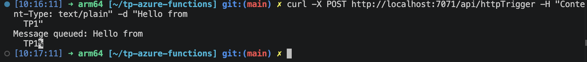
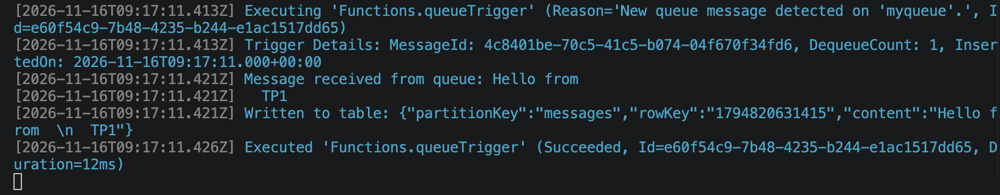

# TP 1 – Azure Functions (Serverless local)

## Description

Ce TP montre comment créer une architecture serverless simple avec Azure Functions en local.
L'idée c'est d'avoir deux fonctions qui communiquent entre elles via une queue, sans s'appeler directement.

---

## Architecture

```
Requête HTTP  →  httpTrigger  →  Queue "myqueue"  →  queueTrigger  →  Table "mytable"
```

**httpTrigger** — reçoit une requête HTTP et met le message dans une queue.

**queueTrigger** — se déclenche automatiquement quand un message arrive dans la queue, et écrit les données dans une table storage.

Les deux fonctions sont indépendantes, elles communiquent seulement via la queue.

---

## Prérequis

- [Node.js](https://nodejs.org/) (v18+)
- [Azure Functions Core Tools](https://learn.microsoft.com/fr-fr/azure/azure-functions/functions-run-local) v4
- Extension VS Code **Azurite** (émulateur Azure Storage local)

Vérifier les installations :

```bash
node --version
func --version
```

---

## Lancer le projet en local

### 1. Installer les dépendances

```bash
npm install
```

### 2. Démarrer Azurite

Dans VS Code : Terminal → `azurite start`

Azurite émule le stockage Azure en local (queue et table storage). Sans ça, les fonctions ne peuvent pas écrire ou lire les messages.

### 3. Démarrer les fonctions

```bash
npm start
```

Les deux fonctions doivent apparaître dans les logs :

```
Functions:
  httpTrigger:   [GET,POST] http://localhost:7071/api/httpTrigger
  queueTrigger:  storageQueue trigger (myqueue)
```

---

## Tester

Envoyer une requête HTTP avec curl :

```bash
curl -X POST http://localhost:7071/api/httpTrigger \
  -H "Content-Type: text/plain" \
  -d "Hello from TP1"
```

**Réponse attendue :**

```
Message queued: Hello from TP1
```



---

## Résultat dans les logs

Après l'appel HTTP, la fonction `queueTrigger` se déclenche automatiquement et écrit le message dans la table storage.



---

## Structure du projet

```
src/
  functions/
    httpTrigger.js    ← fonction HTTP trigger
    queueTrigger.js   ← fonction Queue trigger
host.json             ← configuration du runtime Azure Functions
local.settings.json   ← variables d'environnement locales (connexion Azurite)
package.json
```

---